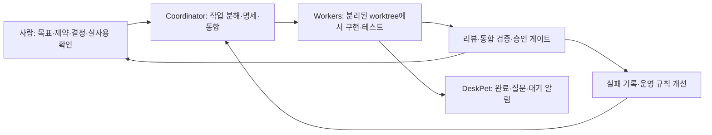

# DeskPet — 멀티 에이전트 오케스트레이션 실험

**여러 AI 에이전트에게 개발 작업을 나누고, 결과를 검증·통합하는 과정을 실제 프로젝트로 실험했습니다.** DeskPet은 그 실험의 산출물이자, 에이전트의 작업 완료·질문·승인 대기를 알려 주는 Windows 데스크톱 펫입니다.

AI로 기능을 생성하는 것에 더해 작업 범위·승인·테스트·자원 사용을 어떻게 관리하고, 실패를 다음 운영 규칙으로 연결했는지 보여 주려는 사례입니다. 게임 프로젝트는 아니며 AI 활용 방식의 보조 사례로 정리했습니다.


위 이미지는 알림 배지의 렌더링 캡처입니다. 기본 캐릭터 wolf-maid의 생성·편집 과정은 [아트 기록](docs/art/base/README.md)에서 볼 수 있습니다.

## 먼저 볼 자료

| 자료 | 내용 |
|---|---|
| [Windows 설치 파일](https://github.com/minsforgh/DeskPet-Desktop/releases/tag/v0.1.0-preview.1) | Preview 설치본·SHA-256. 코드 서명이 없어 PC 보안 정책에 따라 실행이 제한될 수 있음 |
| [실험 사례](docs/SHOWCASE.md) | 역할 분담, 실패 사례, 바꾼 규칙과 한계 |
| [측정 기준선](docs/progress/m14-baseline.md) | 대상·기간·분모를 포함한 지표 |
| [작업 방식](docs/orchestration-guide.md) · [에이전트 규칙](AGENTS.md) | 명세, 작업 분해, 검증과 통합 |
| [실행·시연](docs/DEMO.md) | 소스 실행, 설치본 생성, 시연 순서 |
| [검증 상태](docs/VALIDATION.md) | 이번 확인과 과거 기록의 구분 |
| [공개 사본 안내](docs/PUBLIC-SNAPSHOT.md) | 개인정보 처리와 포함하지 않은 자료 |

## 어떻게 운영했나



Orca의 worktree·오케스트레이션 기능을 이용하고 Claude Code·Codex 등의 에이전트에 작업을 배정했습니다. 사람은 목표·캐릭터·범위 변경과 주요 선택을 결정하고 실제 앱을 사용해 결과를 확인했습니다. 작업 분해·구현·리뷰·문서 작성에는 AI 에이전트가 참여했습니다. [역할과 근거](docs/SHOWCASE.md)를 구분해 기록했습니다.

DeskPet은 오케스트레이션 실행기 자체를 구현한 도구가 아닙니다. 저장소에는 앱·플러그인·SDK·테스트·작업 지침이 있고, 개인 환경의 전역 운영 스크립트와 집계 도구 일부는 포함하지 않습니다.

## 무엇을 측정했나

아래는 **2026-10-17에 고정한 M0–M13 기준선**입니다. 이번 공개 준비에서 새로 측정한 수치가 아니며 생산성 향상을 입증하는 대조 실험도 아닙니다.

| 항목 | 기록된 값 | 해석 |
|---|---:|---|
| 작업 규모 | 18 Run / 229 task / 243 dispatch | 한 프로젝트의 관찰 기록 |
| 첫 시도 완료 | 201 / 226, 약 89% | worker 없이 처리한 3 task 제외. 무결함 비율과 다름 |
| 재시도 task | 25 / 226, 약 11% | dispatch 횟수 기준. 별도 후속 수정 task와 구분 |
| worker 2개 이상 동시 가동 | 가동 시간 중 약 28% | 전체 달력 시간 중 비율과 다름 |
| coordinator 입력 비중 | 약 63% | 캐시 읽기·쓰기를 포함한 입력 측 집계. 비용과 다름 |

[측정 방법과 한계](docs/progress/m14-baseline.md)를 함께 봐 주세요. M14 개선 후 재측정은 아직 완료되지 않았습니다. 원본 대화 로그·운영 DB는 개인정보 때문에 포함하지 않았습니다.

## 실패에서 바꾼 것

- 배지의 내부 상태만 확인한 테스트가 실제 화면에 배지가 없는 결함을 놓쳤습니다. 렌더러의 요소·글자·위치를 확인하도록 규칙을 바꿨습니다.
- Run 1개·즉시 응답 가짜 CLI가 실제 Run 18개의 읽기 지연을 놓쳤습니다. 실제 규모와 명령 지연을 가진 가짜, 실제 CLI 읽기 측정을 검증에 추가했습니다.
- 여러 worker의 e2e가 동시에 돌아 실패했습니다. 작업 트리 공용 실행 잠금과 범위별 검증 규칙을 추가했고 남은 간헐 실패는 M14에서 조사 중입니다.

각 사례의 근거와 남은 문제는 [실험 사례](docs/SHOWCASE.md)에 연결했습니다.

## 직접 실행하기

Windows 10/11 x64, Node.js 22 이상, `package.json`에 지정된 pnpm 버전이 필요합니다. 저장소 루트에서:

```powershell
pnpm install --frozen-lockfile
pnpm exec electron --version
.\start-deskpet.cmd
```

`electron --version`은 첫 실행에 필요한 Electron 바이너리 준비도 확인합니다. 현재 설치된 Electron 패키지는 바이너리가 없으면 다운로드를 시도하므로 첫 실행에는 네트워크가 필요할 수 있습니다. 실패하면 오류를 먼저 확인하세요. 다른 PC 검증과 이번 로컬 검증은 [검증 상태](docs/VALIDATION.md)에서 구분합니다.

외부 연동 없이 펫의 표시·드래그·상호작용·설정을 시연할 수 있습니다. Orca·Slack·LMS·에이전트 hook은 각 도구·계정 설정이 필요한 선택 기능입니다.

설치본은 [Preview Release](https://github.com/minsforgh/DeskPet-Desktop/releases/tag/v0.1.0-preview.1)에서 받을 수 있고 `pnpm package`로 직접 만들 수도 있습니다. 설치 exe는 Git 소스 이력에 포함하지 않고 릴리스 첨부 파일로 제공합니다. [시연 안내](docs/DEMO.md)와 [설치 안내](docs/install.md)를 참고하세요.

## 구현 범위와 현재 상태

- Electron·TypeScript·pnpm 모노레포, 애니메이션·설정 편집, 로컬 이벤트 API, 권한 기반 플러그인 호스트.
- Claude Code·Codex hook, Orca 상태, 리마인더, Slack·Jungle LMS 연동.
- **개발 중인 실험 프로젝트.** 이전 설치본 검증 기록은 있지만 모든 기능이 모든 PC에서 안정적이라고 보장하지 않습니다. 코드 서명은 없고 일부 e2e 안정화·M14 재측정이 진행 중입니다.
- AI 생성 아트와 제작자의 픽셀 수정: [CREDITS](characters/wolf-maid/CREDITS.md). 외부 프로젝트와 Jungle Bell 관계: [출처 안내](docs/PROVENANCE.md).
- 코드·에셋의 별도 재사용 라이선스는 아직 지정하지 않았습니다.
