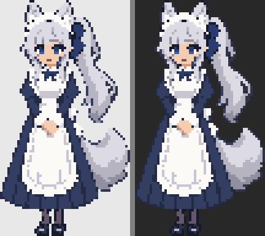
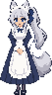
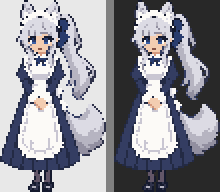
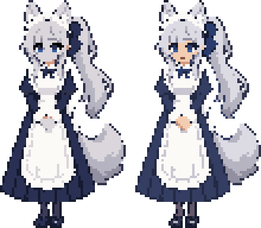
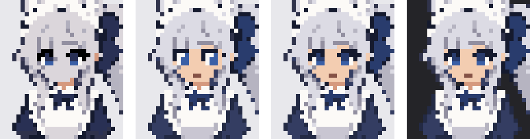
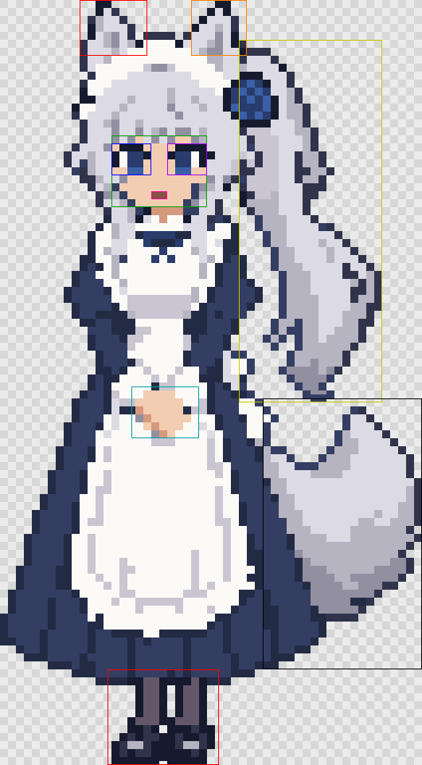

# q2 기준 스프라이트 다듬기 — ART-4

사용자가 D-017에서 고른 q2를 기준으로 했다. [생성 원본](../concepts/2026-10-06-pixel/round2/raw/q2-between-a-p6.png)과 [자동 정리 초안](../concepts/2026-10-06-pixel/round2/processed/h96/q2-between-a-p6.sprite.png), 해당 폴더의 README·NOTES를 먼저 직접 열어 확인했다. 이 작업은 **사용자 확정 전 검토용 한 장**이다. 새 이미지 생성이나 동작 프레임 제작은 하지 않았다.

53×96 캔버스, 약 5등신 성인 체형, 손을 모은 자세, 긴 클래식 메이드복, 은발 포니테일과 늑대 귀·꼬리를 유지했다. 고정 팔레트 15색을 적용하고, [수정 목록](edits.json)의 **60개 순차 수정**을 적용했다. 색 교체를 제외한 불투명/투명 마스크 변화는 전체 5,088픽셀 중 6픽셀뿐이다. 위치 이동이나 크롭은 없다.

## 이미지

실제 원본 크기(53×96):


4배 최근접 확대:


4배 밝은 배경(#e8e8e8)·어두운 배경(#282828):



앱 표시 크기 후보인 정수 2배(106×192). 앱 실행 화면을 캡처한 것은 아니다:




초안(왼쪽)과 다듬은 결과(오른쪽), 동일한 4배율:



## 고정 팔레트

[palette.json](palette.json)의 순서가 색 거리 동률일 때 우선순위다. 픽셀 수는 [base.json](base.json)의 실제 크기 기준이다. 불투명 2,864픽셀, 투명 2,224픽셀, 반투명 0픽셀이다. 강조점은 흰 앞치마색을 공유하므로 별도의 흰색을 중복 등록하지 않았다.

| 역할 이름 | hex | 픽셀 수 | 용도 |
|---|---|---:|---|
| outline | #151a2e | 119 | 외곽선·속눈썹·밑창 |
| dress-shadow | #232a44 | 255 | 의복 주름과 소매 그림자 |
| dress | #343d62 | 531 | 긴 남색 메이드복의 면 |
| ribbon | #293c6d | 57 | 머리와 목 리본 |
| hair-shadow | #928fa0 | 92 | 은발과 꼬리의 깊은 음영 |
| hair-mid | #b6b4c1 | 281 | 거의 같은 여섯 회은색을 합친 중간톤 |
| hair-light | #dcdbe4 | 503 | 차가운 은발과 털의 밝은 면 |
| skin | #f3cdb1 | 79 | 얼굴과 맞잡은 손 |
| skin-shadow | #d5997e | 9 | 목과 손 가장자리 |
| eye | #3a5fa6 | 10 | 푸른 홍채 |
| apron | #fcfaf7 | 690 | 앞치마·프릴·흰자·눈 강조점 |
| apron-shadow | #c9c6d2 | 91 | 천 경계와 접힘 |
| shoe | #30334b | 120 | 신발과 일부 외곽의 중간 남색 |
| stocking | #635769 | 25 | 스타킹 |
| mouth | #855246 | 2 | 닫힌 작은 입 |

## 고친 곳과 보존한 곳

- 초안의 검정과 유사 남색은 외곽·의복 면·의복 음영으로 정리했다. 작은 실루엣이 어두운 배경에서도 구분되도록 의복 면을 약간 밝게 했다.
- 회색으로 합쳐졌던 얼굴과 손을 따뜻한 피부색으로 복원했다. 양쪽 눈은 같은 모양과 크기이며, 각각 2×3 홍채 면 안에 흰 강조 한 점을 넣었다. 실제 푸른 픽셀은 각 5개다. 입은 (19,24)와 (20,24)의 두 픽셀이며 목 리본과 떨어져 있다.
- 귀의 끊긴 가장자리와 내부 음영의 좌우 균형, 머리 프릴 아래 경계, 머리·목 리본 색을 정돈했다. 비대칭으로 흐르는 머리카락과 귀의 원래 폭은 보존했다.
- 앞치마의 은발색 잔여 음영을 천의 그림자로 분리하고, 치마와의 기존 경계를 유지했다. 손을 새로 그리지 않고 기존 내부 색만 바꿨다.
- 두 신발 사이의 붙은 네 픽셀을 지우고 반사점을 두 픽셀씩 맞췄다. 두 발의 기존 밑창 행이 이미 같아 그 위치는 유지했다.
- 포니테일 끝 갈래의 작은 틈 한 픽셀을 잇고 꼬리 아래의 돌출 한 픽셀을 제거했다. 넓게 흐르는 포니테일과 꼬리의 형태는 유지했다.

## 발 위치 — 이후 anchor 참고

좌상단 픽셀을 (0,0)으로 세는 **0 기반 픽셀 인덱스 좌표**다. 완전 불투명인 최하단 행에서 두 발의 연속 구간을 측정했다.

| 측정 | 왼발(화면 왼쪽) | 오른발(화면 오른쪽) |
|---|---:|---:|
| 밑창 최하단 행 y | 95 | 95 |
| 그 행의 x 구간(양 끝 포함) | 15–19 | 21–25 |
| 구간 가로 중심 x | 17 | 23 |

양발 중심의 중점은 **(20,95)**. 연속 좌표에서 픽셀 셀의 기하학적 중심으로 해석하면 (20.5,95.5), 바닥 경계선은 y=96이다. 이후 매니페스트가 사용하는 좌표 규약에 맞춰 선택해야 한다. 2배 이미지에서 밑창 마지막 행은 191이며, 각 밑창의 픽셀 인덱스 중심은 34.5와 46.5다. 이번 작업에서 캐릭터 매니페스트는 변경하지 않았다.

## 직접 열어 보고 판단한 것과 남은 약점

2026-10-06에 원본·초안·최종 sprite, 4배 preview/check, 2배 이미지/check, before-after를 이미지 보기 도구로 직접 열었다. 첫 결과를 본 뒤 스타킹의 색 역할과 머리 리본 색을 추가로 바로잡았고 다시 열어 확인했다.

따뜻한 피부와 차가운 은발이 분리되어 읽히고, 작은 푸른 눈과 입도 알아볼 수 있다. 두 배 크기에서 긴 치마와 성인 체형, 포니테일과 꼬리의 구분이 유지된다. 밝은 배경에서는 흰 프릴 끝이 약하고, 어두운 배경에서는 남색 외곽선 일부가 배경과 가깝지만 의복 면의 경계는 읽힌다.

눈은 초안보다 각지고 또렷해져 표정이 조금 더 깨어 있는 인상이다. 53×96에서 한 픽셀 강조의 영향이 크므로 실제 앱 크기에서 사용자의 판단이 필요하다. 귀와 머리 프릴의 밝은 면이 일부 이어져 보이고, 포니테일 끝의 가는 갈래에는 원본의 불균일한 계단이 남아 있다. 손은 손가락이 분리되지 않은 작은 맞잡은 덩어리다. 전면적인 재설계 없이 보존하기 위해 이 한계는 남겼다.

## 다시 만들기와 검증

저장소 루트에서 전체 산출물을 다시 만드는 한 줄:

```sh
node docs/art/base/rebuild.mjs
```

[rebuild.mjs](rebuild.mjs)는 먼저 아래 공개 CLI를 실행한 뒤 같은 PNG 모듈로 정수 2배와 전후 비교를 만든다:

```sh
pnpm sprites:retouch docs/art/concepts/2026-10-06-pixel/round2/processed/h96/q2-between-a-p6.sprite.png --palette docs/art/base/palette.json --edits docs/art/base/edits.json --out docs/art/base --name base
```

RGB 제곱 거리로 가장 가까운 고정 색을 고르고, 동률이면 팔레트의 앞 색을 사용한다. 수정은 배열 순서대로 적용한다. 반투명 입력·없는 색 이름·좌표 이탈·잘못된 파일 형식은 오류다. 출력에 타임스탬프가 없으며 같은 입력은 같은 바이트다. 공개 CLI 반복 실행 테스트와 재생성 진입점 테스트에서 이미지·메타데이터 7개 파일의 바이트, 팔레트·알파, 양쪽 눈 모양, 밑창 행과 중심, 2배 픽셀 복제, README 링크를 확인한다.

2026-10-06 검증: `pnpm typecheck`, `pnpm lint`, `pnpm test`(13개 파일·129개 테스트), `pnpm build` 모두 exit 0. `pnpm sprites:check characters/placeholder characters/placeholder-alt`도 두 팩 모두 통과했다. 앱 소스는 변경하지 않았으므로 이번 범위에서 e2e는 실행하지 않았다.

첫 전체 테스트의 실패는 CLI 테스트 여러 개가 같은 dist를 동시에 빌드한 경합과 기존 5초 제한 때문이었다. 빌드하는 테스트를 한 파일에서 순차 실행하도록 모으고, 두 번 실행하는 테스트는 Windows 전체 테스트에서 측정한 최대값(retouch 8,044ms, pixelize 9,649ms)의 두 배를 제한으로 잡았다. 이미지 검증 조건과 기존 pixelize/check 처리 동작은 유지했다.

## 사용자에게 물을 질문

1. 눈 크기와 강조 한 점이 지금처럼 또렷한 편이 좋나요, 초안처럼 차분하게 줄이는 편이 좋나요?
2. 얼굴과 손의 따뜻한 피부색이 은발·남색 옷과 잘 어울리나요?
3. q2의 긴 치마 길이와 작은 신발 노출을 그대로 기준으로 확정해도 될까요?
4. 실제 표시 후보인 2배(106×192)에서 귀·프릴과 손의 단순화 정도가 충분히 읽히나요?

## 사용자 피드백

- **2026-10-06:** 눈을 다듬기 전 초안(q2)의 형태로 되돌려 달라는 요청. 눈동자가 더 잘 보이게.
  - 반영: 눈 부분의 수정 12건을 초안의 눈 모양(윗속눈썹, 어두운 남색 눈동자, 아래쪽 푸른 홍채, 바깥쪽 흰 강조)을 따르는 18건으로 바꿨다. 피부색 복원과 나머지 수정은 그대로다.
  - 눈동자 색은 팔레트의 리본 남색(`ribbon`)을 썼다. 처음에 더 어두운 남색(`dress-shadow`)을 썼더니 외곽선과 구분되지 않아 눈이 검은 덩어리로 보였다.
  - 비교: `eyes-compare.png` (왼쪽부터 초안, 첫 다듬기, 지금, 지금을 어두운 배경에 올린 것. 얼굴 부분을 7배 확대)

  

## 부위 지도 (2026-10-07)

`base_final.png`(106x192, 15색, 알파 0/255)가 최종 기준 아트이고(D-018), 9개 동작 프레임은 이 이미지에 편집을 적용해 코드로 만든다(D-019). 편집 목록이 가리킬 영역은 `parts.json` 에 있다: 귀 2, 얼굴·눈 2·입, 손, 포니테일, 꼬리, 다리. 좌표를 겹쳐 그린 그림은 `parts-overlay.png`.



- 눈은 윗줄 속눈썹(y36-37), 하이라이트, 홍채(리본 색), 눈 색 줄(y42-43)로 이뤄져 있다. 깜빡임은 홍채·눈 색을 피부색으로 덮고 속눈썹 줄만 남기는 편집이다.
- 발 아랫변은 행 191, 두 발의 가로 중심은 x40.5 (매니페스트 anchor 후보).
- 알려진 한계: base_final 은 2x 블록이 균일하지 않은 곳이 5곳이다(사용자가 106x192 에서 직접 손본 부분). 부위 편집은 106x192 기준으로 한다.
