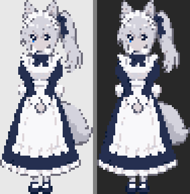
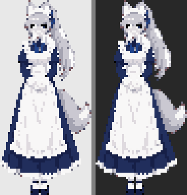
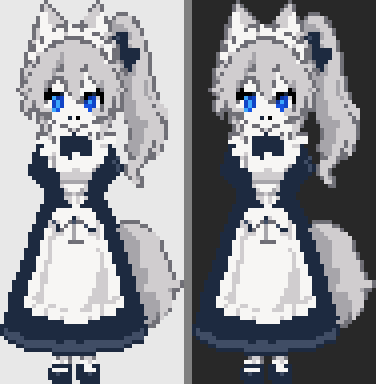
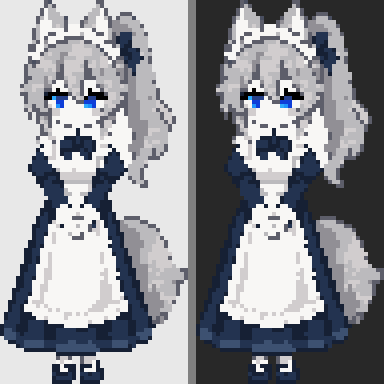

# 픽셀 기준 이미지 후보 (2026-10-06)

캐릭터 스타일이 픽셀 아트, 디자인 A로 정해진 뒤(결정 D-002) 만든 후보입니다. 정면으로 서 있는 **기준 이미지 한 장**을 고르기 위한 자료이고, 확정이 아닙니다. 동작 프레임은 아직 만들지 않았습니다.

- **생성 원본:** `raw/` (이미지 생성 도구, 약 1024px 크기의 "픽셀풍" 그림)
- **정리 결과:** `processed/h96/`, `processed/h64/`, `processed/h48/` (`pnpm sprites:pixelize`로 실제 격자와 16색 이하 팔레트로 정리)
- **생성 프롬프트와 worker의 평:** `NOTES.md`

아래 그림은 정리 결과를 4배로 키워 밝은 배경과 어두운 배경에 올린 것입니다. 실제 스프라이트는 높이 96px입니다.

## 후보

### p1 — 키 큰 비율, 굵은 도트

- 5–6등신. 긴 치마와 성인 체형이 잘 남습니다.
- 눈은 지난 시안보다 커졌지만 여전히 작은 편입니다.

### p2 — 키 큰 비율, 세밀한 도트

- "장신 메이드" 느낌이 가장 강합니다.
- 얼굴이 가장 작아 표정을 읽기 어렵습니다. 작은 크기에서는 세부가 뭉개질 수 있습니다.

### p3 — 중간 비율, 굵은 도트

- 3.5–4등신. 눈이 크고 밝은 파란색이라 멀리서도 눈에 띕니다.
- 면이 커서 정리하기 쉽고, 프레임을 늘릴 때 일관성을 맞추기 유리합니다.
- 턱 아래 리본이 어두운 덩어리로 보여 입처럼 읽힐 수 있습니다.

### p4 — 중간 비율, 세밀한 도트

- p3와 같은 비율에 표정(미소)이 조금 더 또렷합니다.
- p3와 차이가 크지 않습니다. 리본이 어둡게 뭉치는 점도 같습니다.

### p5 — 작은 비율, 아주 굵은 도트

- 2.5–3등신. 얼굴이 가장 커서 표정이 가장 잘 읽힙니다.
- 레트로 게임 캐릭터 느낌입니다. 키 큰 성인 인상은 약합니다.
- 높이 48px로 정리한 것도 있습니다: `processed/h48/p5-small-48.check.png`

### p6 — worker의 추천 조합

- 큰 눈과 긴 치마의 균형을 노린 한 장입니다. worker가 여섯 중 1순위로 꼽았습니다.
- 얼굴이 읽히면서 키 큰 인상도 어느 정도 남습니다.

## 비교

| 후보 | 등신 | 표정 가독성 | 장신 메이드 느낌 | 정리된 색 수 (96px) |
|---|---|---|---|---|
| p1 | 5–6 | 보통 | 강함 | 16 |
| p2 | 5–6 | 약함 | 가장 강함 | 16 |
| p3 | 3.5–4 | 좋음 | 보통 | 15 |
| p4 | 3.5–4 | 좋음 | 보통 | 14 |
| p5 | 2.5–3 | 가장 좋음 | 약함 | 16 |
| p6 | 약 4–4.5 | 좋음 | 보통–강함 | 16 |

표정 가독성과 느낌은 coordinator가 정리 결과를 직접 열어 보고 적은 인상입니다. 측정값이 아닙니다.

## 확인된 것과 한계

- 여섯 장 모두 은발 포니테일, 푸른 눈, 늑대 귀와 꼬리, 남색 메이드복과 흰 앞치마가 들어 있고 발끝까지 보입니다.
- 정리 결과는 모두 16색 이하이고, 어두운 배경에서 흰 테두리가 보이지 않습니다.
- 정리 과정에서 색을 줄이면서 얼굴 피부색이 회색에 가깝게 바뀐 후보가 있습니다(p1, p2). 기준 이미지를 고른 뒤 팔레트를 손으로 다듬어야 합니다.
- 높이 64px로 줄인 결과(`processed/h64/`)는 얼굴이 많이 뭉개집니다. 96px 쪽이 낫습니다.
- 앱에서 픽셀 그림이 또렷하게 보이려면 정수 배율(예: 96px 스프라이트를 2배로)로 그려야 합니다. 지금 앱은 256px 셀을 0.6배로 줄여 그리는 설정이라, 실제 팩으로 넣을 때 셀 크기와 배율을 다시 정해야 합니다.
- 이것은 서 있는 한 장입니다. 9개 동작(대기, 깜빡임, 걷기, 잠, 기쁨, 놀람, 걱정, 말하기, 드래그)에서 같은 캐릭터로 유지하는 것이 다음의 어려운 부분입니다.

## 주의

이미지 생성 도구 약관의 상업적 이용 조건과 AI 생성 이미지의 저작권은 확인하지 않았습니다. 공개 배포 전에 확인이 필요합니다(기획안 9-5).

## 피드백 받을 질문

1. 여섯 중 기준으로 삼을 한 장은 무엇인가요? (둘을 섞고 싶으면 "p6의 비율에 p3의 눈"처럼 적어 주세요)
2. 고친다면 무엇을 바꿀까요? (눈 크기, 귀·꼬리 크기, 치마 길이, 머리 장식, 색)
3. 스프라이트 높이는 96px 정도가 적당한가요, 더 굵은 도트(64px)나 더 세밀한 쪽(128px)을 원하나요?

## 사용자 피드백

- **2026-10-06:** p5, p6, 그리고 전날 만든 a-pixel(`../2026-10-06/a-pixel.png`, 정리 결과는 아직 이 폴더에 없음)의 디자인 방향이 가장 낫다.
