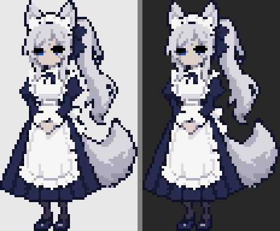
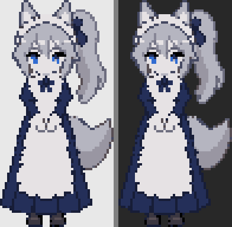
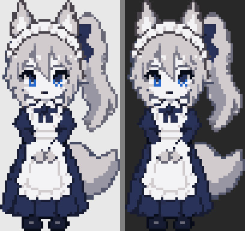
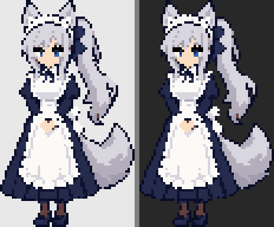
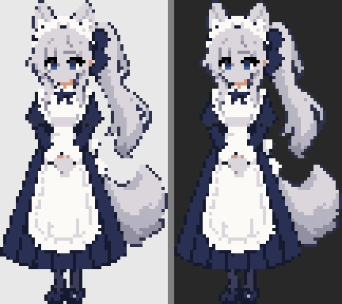
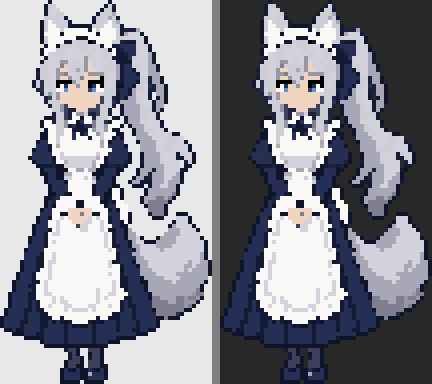
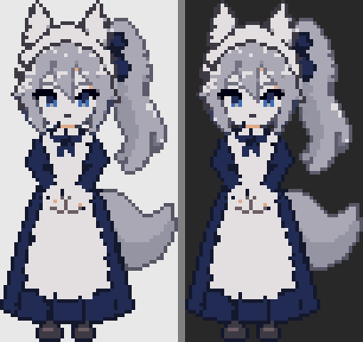
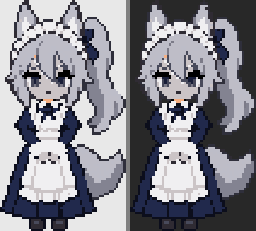

# 픽셀 기준 이미지 2차 후보 (2026-10-06)

1차 후보 중 사용자가 방향이 낫다고 한 세 장(a-pixel, p5, p6) 사이에서 비율만 단계적으로 바꿔 다시 뽑은 다섯 장입니다. 정면으로 서 있는 **기준 이미지 한 장**을 고르기 위한 자료이고, 확정이 아닙니다.

- **생성 원본:** `raw/`
- **정리 결과 (높이 96px, 16색 이하):** `processed/h96/`
- **생성 프롬프트와 worker의 평:** `NOTES.md`

아래 그림은 정리 결과를 4배로 키워 밝은 배경과 어두운 배경에 올린 것입니다.

## 기준이 된 세 장 (1차)

| a-pixel | p6 | p5 |
|---|---|---|
|  |  |  |
| 5–6등신, 눈이 작고 어두움 | 약 4–4.5등신 | 2.5–3등신 |

## 2차 후보

### q1 — a-pixel 그대로, 눈만 크게

- a-pixel의 키 큰 비율과 디자인이 거의 그대로이고, 눈이 푸르게 보입니다.
- 얼굴이 여전히 작아서 표정 변화를 그릴 공간은 가장 적습니다.

### q2 — a-pixel과 p6의 중간

- 약 5등신. 긴 치마와 어른스러운 인상이 남아 있고, 얼굴이 q1보다 조금 큽니다.
- 피부색이 따뜻하게 살아 있고 눈이 또렷합니다.

### q3 — p6 비율에 a-pixel의 색과 긴 치마

- worker가 1순위로 꼽았습니다. 얼굴이 읽히면서 키 큰 실루엣이 유지됩니다.
- q2와 차이가 크지 않습니다. q2보다 머리가 약간 크고 표정이 차분합니다.

### q4 — p6과 p5의 중간

- 약 3.5등신. 머리가 크고 눈이 밝은 파란색이라 표정이 잘 읽힙니다.
- 색을 줄이면서 피부가 회색에 가깝게 바뀌었습니다. 다듬어야 합니다.
- 1차의 p3, p4와 인상이 비슷해졌습니다(밝은 눈).

### q5 — p5 비율에 치마를 조금 길게

- 2.5–3등신. 얼굴이 가장 큽니다.
- 정리 결과에서 눈이 푸른색이 아니라 어둡게, 피부가 회색으로 나왔습니다. 컨셉(푸른 눈)에서 벗어나 그대로는 쓰기 어렵습니다.

## 비교

| 후보 | 등신 | 표정 가독성 | 장신 메이드 느낌 | 정리 후 색 문제 |
|---|---|---|---|---|
| q1 | 5–6 | 보통 | 가장 강함 | 없음 |
| q2 | 약 5 | 보통–좋음 | 강함 | 없음 |
| q3 | 약 4.5 | 좋음 | 강함 | 없음 |
| q4 | 약 3.5 | 좋음 | 보통 | 피부가 회색 |
| q5 | 2.5–3 | 가장 좋음 | 약함 | 피부가 회색, 눈이 어두움 |

표정 가독성과 느낌은 coordinator가 정리 결과를 직접 열어 보고 적은 인상입니다. 측정값이 아닙니다.

## 확인된 것과 한계

- 다섯 장 모두 은발 포니테일, 늑대 귀와 꼬리, 남색 메이드복과 흰 앞치마가 들어 있고 발끝까지 보입니다. 1차에서 문제였던 "턱 아래 리본이 입처럼 보이는" 현상은 q1–q3에서 보이지 않습니다.
- q1, q2, q3은 서로 많이 닮았습니다. 방향을 좁힌 결과이고, 셋 중 어느 것을 골라도 같은 캐릭터로 읽힙니다.
- 생성 원본에는 미세한 음영과 고르지 않은 도트가 남아 있습니다(worker 기록). 정리 명령이 16색 이하로 줄였지만, 기준 이미지를 고른 뒤에는 팔레트와 일부 픽셀을 손으로 다듬어야 합니다.
- 이것은 서 있는 한 장입니다. 9개 동작에서 같은 캐릭터로 유지하는 것이 다음의 어려운 부분입니다.

## 주의

이미지 생성 도구 약관의 상업적 이용 조건과 AI 생성 이미지의 저작권은 확인하지 않았습니다. 공개 배포 전에 확인이 필요합니다(기획안 9-5).

## 피드백 받을 질문

1. 기준으로 삼을 한 장은 무엇인가요? (1차의 a-pixel, p5, p6도 포함해서 골라도 됩니다)
2. 고친다면 무엇을 바꿀까요? (눈 크기와 색, 귀·꼬리 크기, 치마 길이, 머리 장식)
3. 고른 그림을 그대로 다듬을까요, 한 번 더 변형을 볼까요?

## 사용자 피드백

- **2026-10-06:** `q2-between-a-p6` 을 초안으로 선택.
