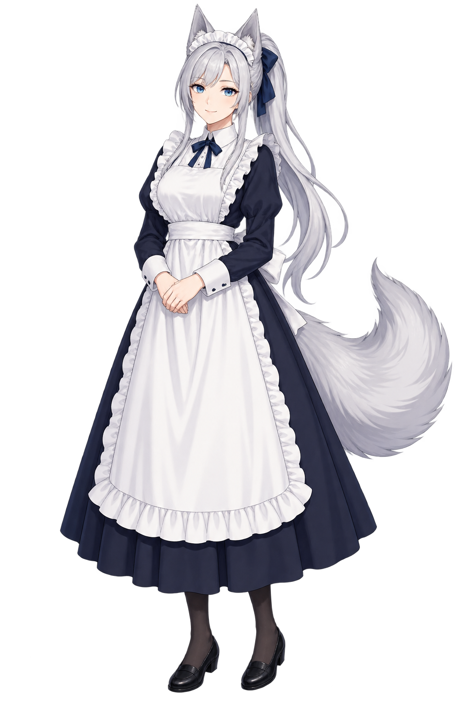
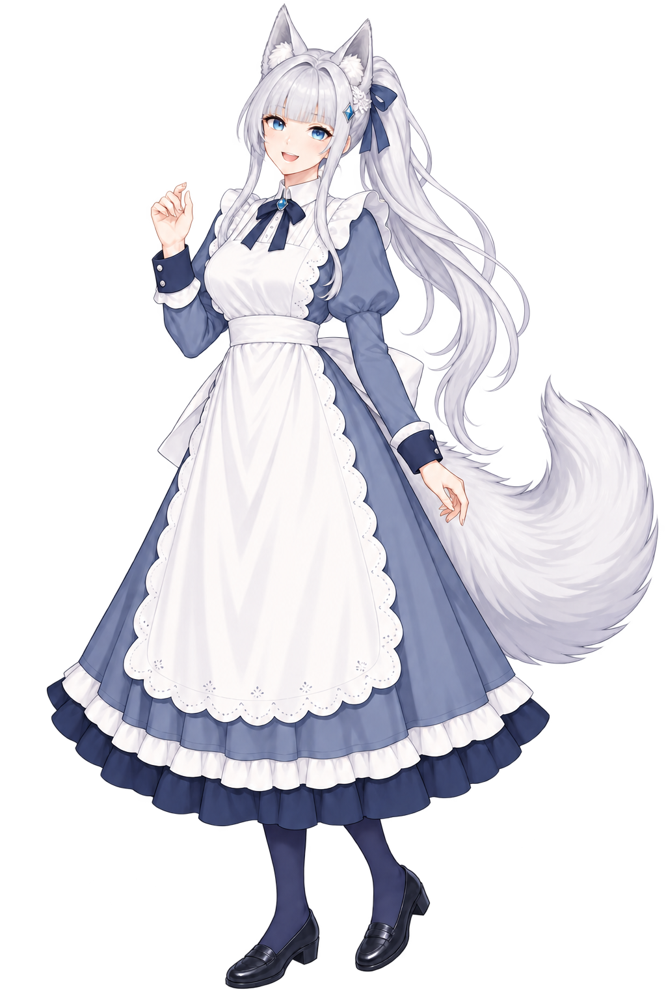
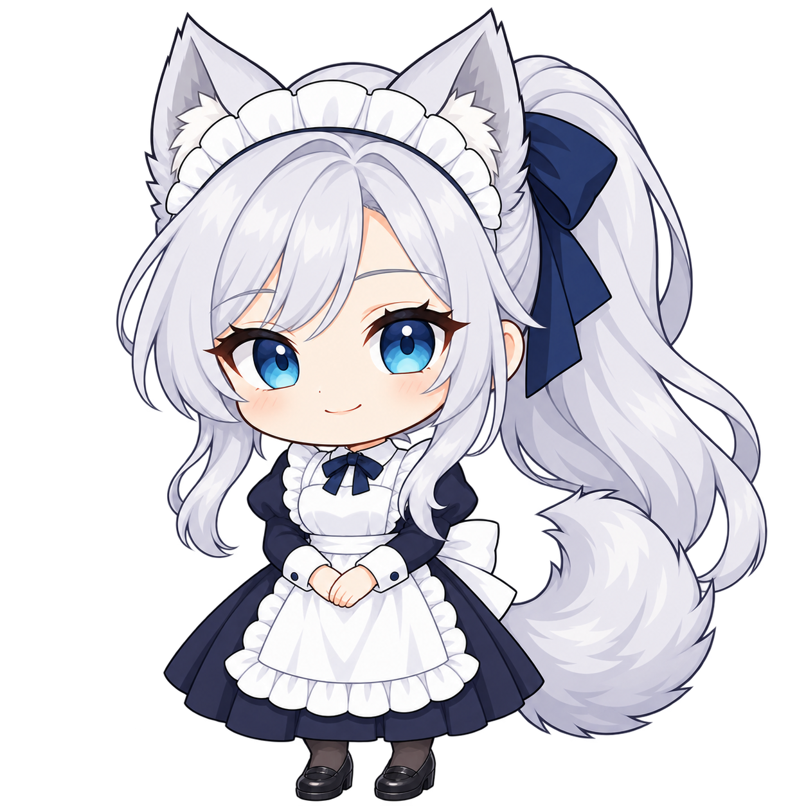
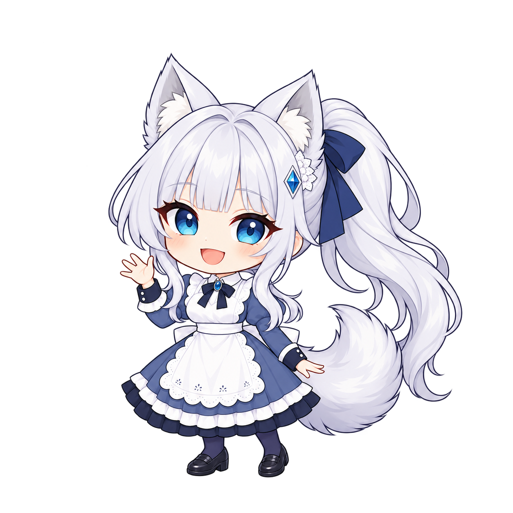
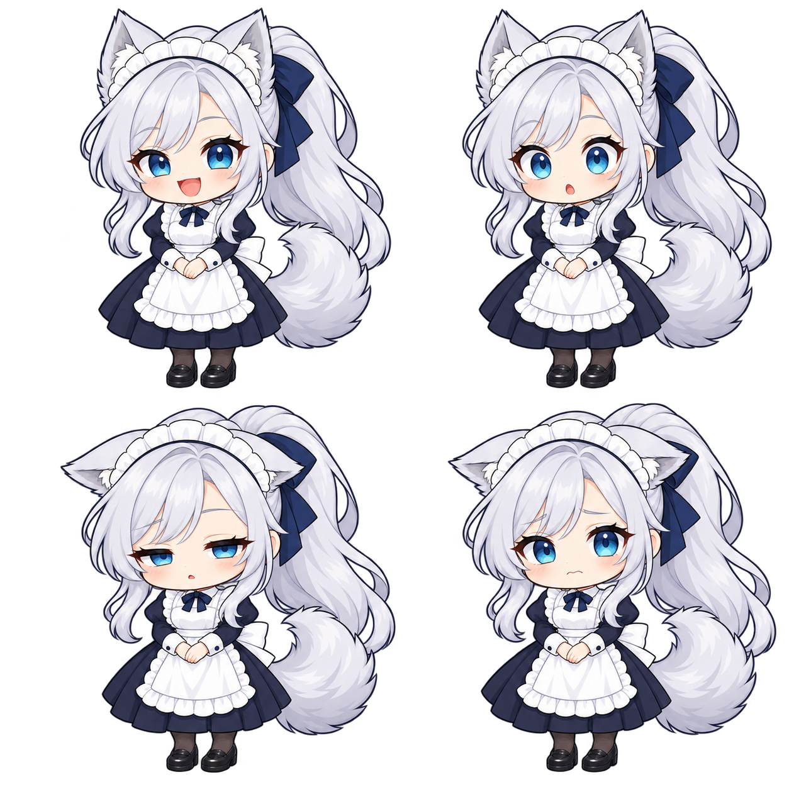

# DeskPet 캐릭터 아트 시안

날짜: **2026-10-06**

컨셉: 일본 애니메이션 스타일의 오리지널 성인 캐릭터. 은발 포니테일, 푸른 눈, 늑대 귀와 꼬리를 가진 키 큰 메이드이며 단정한 클래식 메이드복을 입습니다.

**사용자 피드백을 받기 위한 시안이며 확정이 아님.**

기획안 9장과 결정 D-002(캐릭터 스타일)를 위한 병행 아트 자료입니다. A는 차분하고 믿음직한 방향, B는 밝고 장난기 있는 방향입니다. 치비는 같은 성인 캐릭터를 2–2.5등신으로 데포르메한 표현입니다.

내장 `image_gen` 도구로 생성했으며 코드로 그림을 그리거나 인터넷 이미지를 내려받지 않았습니다. 생성된 PNG는 후처리 없이 복사했습니다. 모든 최종 PNG를 로컬 이미지 보기 도구로 직접 열어 확인했습니다. 실제 앱 표시 크기(약 150px), 밝고 어두운 배경 합성, 애니메이션 루프 및 발 기준점 오차는 이번 작업에서 검증하지 않았습니다.

**먼저 비교할 점:** A/B의 인상 → 일러스트/치비/픽셀의 비율 → 네 감정의 강도. 픽셀 시안은 두 번 수정했으나 엄밀한 저해상도 격자·팔레트 조건이 남아 있으므로 아래 한계를 함께 봐 주세요.

## A-illustration — 차분하고 믿음직한 일러스트



남색과 흰색, 옆으로 넘긴 앞머리와 주름 머리띠로 차분한 인상을 잡았습니다. 긴 치마와 모은 손으로 안정적인 기본 대기 자세를 제안합니다.

- 참조: 참조 이미지 없이 생성한 A 기준 디자인.
- 재시도: 없음(1회 생성).
- 직접 확인한 조건: 전신·양쪽 신발·귀 끝·꼬리 끝 모두 보임. 은발 높은 포니테일, 푸른 눈, 늑대 귀와 꼬리, 단정한 긴 메이드복 확인. 성인 체형과 큰 키의 비율이며 정면에 가까운 자세. 글자·워터마크·테두리·배경 소품 없음. 투명 알파 확인.
- 스스로 본 약점: 포니테일과 꼬리가 같은 쪽에 있어 축소 시 겹칠 수 있습니다. 앞치마 주름과 머리카락 선이 많고, 귀 위 여백이 좁습니다.

<details>
<summary>사용한 최종 프롬프트 전문</summary>

```text
Use case: stylized-concept.
Asset type: original desktop companion character design A, full-body Japanese anime illustration.
Create ONE original adult woman, clearly in her twenties, tall elegant adult proportions, calm trustworthy gentle closed-mouth smile, clear bright blue eyes. Silver hair in a long high ponytail tied with a plain navy ribbon, tidy side-parted bangs, two silver wolf ears with gray inner fur, one large fluffy silver wolf tail curving outward beside her skirt so its full silhouette is visible. Small white pleated maid headband situated between the wolf ears. Modest classic navy-black maid dress: high white collar, long sleeves with white cuffs, fitted but not tight bodice, long calf-to-ankle skirt, broad white rectangular bib apron with a softly rounded hem and restrained ruffles, small navy bow at the throat, opaque dark stockings, closed black low-heeled shoes. All clothing is fully covering and non-suggestive.
Polished clean Japanese anime line art and restrained cel shading. Front or very slight three-quarter front view, standing relaxed with both hands gently clasped at waist. Entire body from ear tips and ponytail to both shoe soles visible, tail tip visible; generous empty margin around every extremity, feet clearly separated from bottom edge. One character only, no other views.
Transparent background with real alpha; no floor, scenery, props, shadow plane, letters, captions, symbols, watermarks, borders, or decorative framing. This must be a wholly original design, with no resemblance to any existing fictional character.
```

</details>

## B-illustration — 밝고 장난기 있는 일러스트



같은 인물의 청회색 복장, 수평 앞머리, 작은 레이스·파란 마름모 장식과 둥근 스캘럽 앞치마를 비교합니다. 열린 미소와 가볍게 든 손으로 밝고 친근한 인상을 제안합니다.

- 참조: 최초 생성은 A 일러스트 참조. 최종 수정은 B 최초 결과를 참조.
- 재시도: 1회. 최초 결과의 앞머리가 A와 비슷해 이마를 덮는 수평 앞머리로 수정했습니다.
- 직접 확인한 조건: 전신과 양쪽 신발, 두 귀, 포니테일과 꼬리가 잘리지 않음. 성인 체형·큰 키, 푸른 눈과 은발, 긴 소매와 무릎 아래 치마 확인. A와 다른 앞머리·머리 장식·복장 배색·앞치마 가장자리 확인. 글자·워터마크·테두리·배경 소품 없음. 투명 알파 확인.
- 스스로 본 약점: A와 얼굴·포즈 차이는 읽히지만 ‘장난기’보다 ‘상냥함’에 가깝습니다. 치마는 요청한 종아리 중간보다 길게 나왔고, 레이스 세부는 작은 화면에서 사라질 수 있습니다.

<details>
<summary>사용한 최종 프롬프트 전문</summary>

```text
Use case: identity-preserve.
Edit target: reference image 1, the full-body original adult silver-haired blue-eyed wolf maid design B.
Make ONE targeted change: replace her side-swept parted fringe with a clearly horizontal straight blunt fringe across the entire forehead, ending just above the eyebrows. The forehead must be covered by this straight fringe, with no center part and no long diagonal swept bangs. Keep two long face-framing side locks and her high silver ponytail.
Preserve everything else: tall adult proportions, bright playful open smile, blue diamond hair clip with small white lace decoration, navy ponytail ribbon, two silver wolf ears, one large silver wolf tail, slate-blue modest classic long-sleeved high-collar maid dress with below-knee skirt and navy hem, scalloped ivory apron, opaque navy stockings, closed dark shoes, raised greeting hand, same illustration style.
Full body including both entire shoes, ear tips, ponytail and tail tip within generous margins. Transparent background with real alpha. No text, captions, symbols, watermarks, borders, props, background scenery, or other figures.
```

</details>

<details>
<summary>생성 이력: 최초 프롬프트</summary>

최초 프롬프트:

```text
Use case: stylized-concept.
Asset type: original desktop companion character design B, full-body Japanese anime illustration.
Input image 1 is a character identity reference: preserve the same adult woman in her twenties, tall adult proportions, silver high ponytail, bright blue eyes, silver wolf ears, and one fluffy silver wolf tail. Create a clearly different costume and hair design direction with a bright playful friendly open smile. Change the side-parted bangs to neat airy straight bangs with two face-framing locks; tie the high ponytail with a small dusty-blue ribbon with two little bow loops. Replace the pleated headband with a small white lace hair clip and a plain blue diamond-shaped hair ornament, unobstructed wolf ears. Modest classic maid dress with high white collar, long sleeves, muted slate-blue fabric, navy cuffs and hem, an ivory rounded scalloped bib apron ending over the below-knee mid-calf skirt, small blue neck ribbon, opaque navy stockings and closed dark low-heeled shoes. No cleavage, no exposed thighs, no suggestive pose.
Clean Japanese anime line art, restrained cel shading matching the reference illustration. Standing in a slight three-quarter front view, one hand lightly lifted in a small friendly greeting and the other relaxed. Whole ponytail and fluffy tail extend visibly away from the body. One character only, complete full body from wolf ear tips through both entire shoe soles with generous transparent margin on all sides.
Genuinely transparent alpha background. No scenery, floor, props, text, symbols, labels, borders, watermark, or extra character. Original design, no existing character resemblance.
```

</details>

## A-chibi — 차분한 A의 치비



A의 성인 캐릭터를 큰 머리와 짧은 몸의 약 2–2.5등신 치비로 변환했습니다. 머리띠·남색 리본·모은 손을 유지해 일러스트 A와 연결합니다.

- 참조: 최초 생성은 A 일러스트 참조. 최종 수정은 A 치비 최초 결과를 참조.
- 재시도: 1회. 최초 결과가 약 3등신으로 길쭉해 머리 대비 몸 길이를 줄이고 의상 주름과 머리카락 세부를 단순화했습니다.
- 직접 확인한 조건: 머리 정수리부터 턱까지를 기준으로 육안상 약 2등신대(귀는 등신 계산에서 제외). A 성인 캐릭터의 데포르메이며 키 큰 성인 실루엣 자체는 일러스트에 보존. 전신·두 신발·귀·포니테일·꼬리 모두 확인. 은발·푸른 눈·늑대 특징과 단정한 메이드복 유지. 글자·워터마크·테두리·소품 없음. 투명 알파 확인.
- 스스로 본 약점: 큰 포니테일과 꼬리가 맞닿아 경계가 약합니다. 치마 길이는 치비 비율로 압축되어 원본의 긴 다리 인상은 줄어듭니다. 귀 위 여백이 좁고 가장자리의 밝은 잔선은 실제 배경에서 추가 검수해야 합니다.

<details>
<summary>사용한 최종 프롬프트 전문</summary>

```text
Use case: style-transfer.
Reference image 1 is design A of an original adult wolf maid. Redesign the proportions into a SUPER DEFORMED 2.2-head-tall chibi mascot on a SQUARE canvas. The previous version is too tall. Measure head height from skull crown to chin, excluding the ears: the entire body from chin to shoe soles must be ONLY 1.2 times that head height. A huge head and a very short compact torso and short legs; the silhouette must be compact, never a tall doll. This is a caricature of an adult woman, not a child.
Preserve the exact recognizable design: silver high ponytail with large navy bow, side-swept bangs, clear blue eyes, two silver wolf ears, white pleated maid headband, one fluffy silver wolf tail, navy-black high-collar long-sleeve modest maid dress, long below-knee skirt, white bib apron with simple rounded ruffle hem, navy neck bow, opaque dark stockings and two closed black shoes. Calm gentle smile with hands together at waist. Keep whole ponytail and tail separately readable. Simplify hair into a few broad locks, dress into flat shapes with very few folds, thick clean anime linework and two cel-shaded tones per material.
Centered single full-body figure, front view. Both feet, both ears, ponytail and tail fully inside the canvas with 8 percent empty margins. Real transparent alpha background. No text, labels, symbols, scenery, floor, props, borders or watermark.
```

</details>

<details>
<summary>생성 이력: 최초 프롬프트</summary>

최초 프롬프트:

```text
Use case: style-transfer.
Asset type: single full-body chibi design A for an original desktop companion.
Reference image 1 defines the original ADULT woman and her exact design. Translate her into a compact 2 to 2.5-head-tall chibi caricature of the same adult character, not a child. Preserve silver high ponytail with plain navy bow, side-parted bangs, vivid blue eyes, two upright silver wolf ears, white pleated maid headband, one fluffy silver wolf tail, modest navy-black long-sleeve high-collar classic maid dress with long below-knee skirt, white rectangular bib apron with rounded ruffled hem, tiny navy throat bow, opaque dark stockings and closed dark shoes. Calm gentle trustworthy expression, hands together near waist.
Use bold clean anime contours, broad flat color shapes, just two or three cel-shading levels, minimal lace detail. Large readable face. Ensure the ponytail and fluffy tail have separate clear shapes outside the body outline, both ears distinct. Front view, one standing figure. Entire character including both shoe soles, ear tips, ponytail and tail tip visible with ample margin. Chibi proportion is the requested stylization of the tall adult source.
Real transparent background, no ground or scenery, no text, labels, symbols, watermarks, borders, accessories in hands, or extra figures.
```

</details>

## B-chibi — 밝은 B의 치비



B의 일자 앞머리·파란 장식·청회색 복장을 A와 비슷한 치비 비율로 맞췄습니다. 손을 흔드는 자세와 큰 미소가 작은 화면에서도 인상을 전달하도록 의도했습니다.

- 참조: 최초 생성은 B 일러스트(디자인)와 A 치비 최종본(비율·스타일)을 함께 참조. 최종 수정은 B 치비 최초 결과를 참조.
- 재시도: 1회. 최초 결과에서 위쪽 귀 끝이 캔버스 경계에 붙어 전체 인물을 작게 배치하고 사방 여백을 확보했습니다.
- 직접 확인한 조건: 최종본은 두 귀·양쪽 신발·꼬리·포니테일 모두 안쪽에 위치하고 전신이 보임. 약 2등신대의 같은 성인 캐릭터 데포르메. 푸른 눈·은발, B의 앞머리와 장식, 긴 소매와 무릎 아래 치마 유지. 글자·워터마크·테두리·소품 없음. 투명 알파 확인.
- 스스로 본 약점: A 치비보다 머리카락 선과 앞치마 무늬가 많습니다. 목 장식 모양이 B 일러스트와 조금 달라 프레임 제작 전 기준 디자인에서 통일해야 합니다.

<details>
<summary>사용한 최종 프롬프트 전문</summary>

```text
Use case: identity-preserve.
Edit target: reference image 1, original adult wolf maid B represented as a 2–2.5-head-tall chibi.
Change framing ONLY: zoom out substantially so this complete unchanged character occupies only the central 75 percent of a square canvas, leaving at least 12 percent transparent empty space above the highest wolf ear, below both shoe soles and on each side. Restore the very tip of the uppermost wolf ear if necessary. No part may touch the edge.
Keep the same design, proportions, pose and friendly open smile: silver high ponytail, straight bangs, bright blue eyes, two silver wolf ears, blue diamond hair clip with white lace, navy ponytail ribbon, one fluffy silver tail, slate-blue long-sleeved high-collar maid dress, white scalloped bib apron, below-knee skirt, opaque stockings and closed shoes. Same clean chibi anime drawing. Do not elongate the body. Single full-body figure, real transparent alpha background. No text, symbols, labels, watermarks, borders, props or scenery.
```

</details>

<details>
<summary>생성 이력: 최초 프롬프트</summary>

최초 프롬프트:

```text
Use case: style-transfer.
Asset type: single full-body chibi design B, original adult desktop companion.
Input image 1 is the character and costume reference for design B. Input image 2 is ONLY the target chibi proportion and drawing-style reference. Transform B into the same compact 2 to 2.5-head-tall chibi caricature of an adult as image 2. Large head, very short body, short legs; crown-to-chin head height is almost half the full crown-to-shoe height. Square composition.
Preserve B specifically: silver high ponytail tied with navy ribbon, straight blunt horizontal bangs covering forehead, blue eyes, blue diamond hair ornament with a small white lace clip instead of a full maid headband, two upright silver wolf ears, one fluffy silver wolf tail, bright playful friendly open smile, one hand raised in greeting. Slate-blue long-sleeved high-white-collar modest maid dress with navy cuffs and hem, ivory scalloped rounded bib apron, blue neck bow, below-knee skirt, opaque navy stockings and closed dark shoes. No bare thighs, no suggestive elements. This is the same adult woman as the source, represented as a chibi mascot.
Bold clean anime outline, simplified flat shapes and sparse cel shading, very few clothing folds or hair strands. Clearly readable distinct ears, ponytail and tail. Whole single standing figure including both shoes, all hair and tail and ears completely within the canvas with empty margins. Genuinely transparent alpha background. No text, labels, watermarks, symbols, borders, scenery, floor, props, or extra figures.
```

</details>

## A-pixel — A의 픽셀 방향 시안


A의 은발·남색 대비와 긴 치마, 귀·꼬리 실루엣을 굵은 도트로 줄여보았습니다. 96–128px급 캐릭터를 확대해 보는 방향을 요청한 시각 비교 자료입니다.

- 참조: 최초 생성은 A 일러스트 참조. 두 번의 수정은 직전 픽셀 결과를 각각 참조.
- 재시도: 2회(허용 상한 도달). 1차 수정은 도트 크기 확대·세부 축소·귀 위 여백 확보, 2차 수정은 균일 격자·16색 제한·발 아래 여백을 강조했습니다. 셋 중 실루엣과 여백이 가장 나은 마지막 결과를 남겼습니다.
- 직접 확인한 조건: 전신·양쪽 신발·두 귀·포니테일·꼬리가 모두 보이고 글자·워터마크·테두리·소품 없음. 은발·푸른 눈·A 복장과 성인 캐릭터 정체성 유지, 투명 알파 확인. 계단형 도트 윤곽은 육안으로 확인했지만 규격은 부분 충족: 실제 PNG는 1254×1254이고, 정확한 96–128px 원본 격자나 정수배 확대물은 확보하지 못했습니다.
- 스스로 본 약점: 16색 제한 미충족: 8px 간격의 불투명 픽셀 표본만으로도 서로 다른 RGB 29색을 확인했습니다(전체 색 수가 아님). 일부 음영과 가장자리에 중간색·미세선이 남고 도트 크기가 완전히 균일하지 않습니다. 입 모양은 A의 부드러운 미소보다 무표정에 가깝습니다. 현재 파일은 앱에 바로 넣을 확정 픽셀 스프라이트가 아니며, 선택 시 실제 저해상도 격자·팔레트 정리가 필요합니다.

<details>
<summary>사용한 최종 프롬프트 전문</summary>

```text
Use case: style-transfer.
Create a single very simple low-resolution pixel sprite of the original adult wolf maid A shown in reference image 1. Preserve the character identity and calm expression but rebuild the rendering with a strict uniform coarse square pixel grid and a flat limited palette of 16 colors plus transparency. Absolutely no smooth shading, no antialiasing or mixed-size pixels. The character should have only about 100 to 112 visible pixel rows from ear tip to sole. Display this tiny sprite as a sharp nearest-neighbor enlarged pixel-art preview, square canvas. Face: just a few blue pixels for each eye, simple tiny mouth; hair and dress shading: only two flat tones each, no detailed strands or lace.
Identity: silver high ponytail with navy bow, side-parted silver bangs, two pointed silver wolf ears, white maid headband, blue eyes, one fluffy silver wolf tail. High white collar, long sleeves, navy-black classic modest below-knee maid dress, broad white rounded bib apron, dark opaque stockings, closed black shoes; adult character represented with compact sprite proportions. Hands together in a relaxed front-facing standing pose.
The FULL character occupies ONLY the central 70 percent of the square image height, with a conspicuous transparent empty band above both ear tips and below both complete shoe soles. Keep ponytail and tail fully visible and away from edges. Transparent alpha background. No labels, letters, symbols, text, grid lines, palette swatches, borders, watermark, scenery, floor, props or extra figures.
```

</details>

<details>
<summary>생성 이력: 최초 프롬프트와 1차 수정 프롬프트</summary>

최초 프롬프트:

```text
Use case: style-transfer.
Asset type: original full-body desktop companion design A, genuine low-resolution pixel art concept.
Input image 1 defines the adult character and exact clothing identity. Recreate her entirely as a crisp PIXEL SPRITE on a logical 128 by 128 pixel grid, character about 112 pixels tall, displayed enlarged by an integer nearest-neighbor scale only. Big visible square pixels and deliberate staircase contours; every edge aligns to the same pixel grid. No smooth lines, no anti-aliasing, no gradients, no blur, no painterly texture. Strict limited palette of 20 flat colors plus transparent. Prioritize readable silhouette over details.
Same original adult silver-haired blue-eyed wolf maid: high silver ponytail with navy bow, side-parted bangs, two upright silver wolf ears, white pleated maid headband, one fluffy silver tail curving outward, dark navy classic high-white-collar long-sleeve modest dress with long below-knee skirt, white bib apron and rounded hem, tiny navy throat bow, opaque dark stockings, closed black shoes. Calm gentle expression. Stylized adult character, compact sprite proportions with recognizable face. Use blue pixels clearly for her eyes, keep ponytail and wolf tail visually distinct.
One standing full-body figure in front view, both entire shoe soles visible and level, whole ears, ponytail and tail inside the canvas, transparent margin around all sides. Real transparent alpha background. No text, letters, labels, grid lines, borders, watermark, floor, scenery, props, extra figures or palette swatches.
```

1차 수정 프롬프트:

```text
Use case: style-transfer.
Reference image 1 is the design identity, not the target detail level.
Make a MUCH COARSER genuine pixel-art version on a square 128x128 logical pixel canvas, with the whole sprite only 104 logical pixels tall. Render that logical canvas at 8x nearest-neighbor enlargement: every single logical pixel is a clearly visible solid 8x8 square. Maximum 20 flat colors, no intermediate shades, no antialiasing, no gradients, no tiny subpixel marks, no smooth outlines. Remove at least half of the previous hair strands, clothing folds and lace details. Use strong deliberate stair-step clusters, minimal readable blue-eye pixels.
Keep the original adult wolf maid A: silver high ponytail tied with navy bow, side-parted bangs, two silver wolf ears, white maid headband, blue eyes, one large silver wolf tail, calm gentle face, modest navy-black high-collar long-sleeved dress and long below-knee skirt, white rounded bib apron, dark stockings, black closed shoes. Front-facing standing full body with hands together. Preserve adult identity in compact sprite proportions.
Leave at least 12 logical pixels empty above both COMPLETE pointed wolf ears and below BOTH complete shoe soles; tail and ponytail also completely inside frame, no edge contact. Fully transparent alpha background, one character only, no text or labels, no grid lines or visible grid, no borders, watermark, palette swatches, scenery, floor or props.
```

</details>

## A-chibi-expressions — 기쁨·놀람·졸림·걱정



A 치비의 몸과 복장을 유지하고 얼굴·귀 각도를 바꿔 상태 구분을 비교합니다. 위 왼쪽 기쁨(happy), 위 오른쪽 놀람(surprised), 아래 왼쪽 졸림(sleepy), 아래 오른쪽 걱정(worried)입니다.

- 참조: A 치비 최종본을 참조.
- 재시도: 없음(1회 생성).
- 직접 확인한 조건: 한 장 안의 네 인물 모두 전신·두 신발·귀·꼬리·포니테일이 보임. 은발·푸른 눈과 A의 복장·머리띠가 유지되고, 눈·입·눈썹과 귀 각도로 네 감정이 구별됨. 글자·상태 이름·테두리·워터마크·배경 소품 없음. 투명 알파 확인.
- 스스로 본 약점: 네 인물 사이의 머리·옷·발 위치는 픽셀 단위로 완전히 같지 않습니다. 2×2 표정 비교 시트이며 곧바로 재생할 애니메이션 시트가 아닙니다. 걱정과 졸림은 축소하면 입보다 눈·귀 각도에 의존할 수 있습니다. 가장자리 밝은 잔선과 좁은 위쪽 여백은 후속 검수 대상입니다.

<details>
<summary>사용한 최종 프롬프트 전문</summary>

```text
Use case: identity-preserve.
Asset type: original adult wolf maid A chibi expression comparison sheet with FOUR full-body figures in a clean 2x2 arrangement on one square transparent canvas.
Input image 1 is the exact identity, clothing and chibi style reference. Repeat the SAME adult character caricature in 2 to 2.5-head-tall chibi proportions, same size, same front-facing standing pose with hands clasped near waist, identical costume and hairstyle in all four positions. Change ONLY face expression and subtle ear angle. Each figure must show its complete ears, high ponytail, wolf tail and both complete shoes, with generous transparent gaps between figures and around the entire sheet. Keep each figure fully inside its quadrant, no overlapping.
Top left: HAPPY, clearly joyful open smile and happy blue eyes.
Top right: SURPRISED, wide round blue eyes, raised eyebrows and small round open mouth.
Bottom left: SLEEPY, visibly drooping half-closed blue eyes, relaxed eyebrows, tiny tired mouth.
Bottom right: WORRIED, eyebrows raised at the inner corners, anxious blue eyes and a small downturned mouth.
These words describe expressions only: DO NOT PRINT ANY WORDS OR LABELS.
Keep A design in every figure: silver high ponytail with plain navy ribbon, silver side-parted bangs, two silver wolf ears, white pleated maid headband, blue eyes, one large fluffy silver wolf tail, modest high-collar long-sleeved navy-black classic maid dress with below-knee skirt, white rounded bib apron with simple ruffle, navy neck bow, opaque dark stockings and closed black shoes. Bold simple anime contours, broad cel-shaded shapes. Same original adult character, no child redesign.
Genuinely transparent alpha background. No grid lines, borders, panels, text, letters, punctuation marks, icons, watermarks, props, scenery or floor. Exactly four full-body figures.
```

</details>

## 스타일 비교

아래 평가는 정지 시안 관찰에 근거한 **추정**입니다. 실제 150px 표시나 9개 상태의 프레임 제작을 해 본 결과가 아닙니다.

| 스타일 | 작은 크기 가독성 | 프레임 간 일관성 유지 | 9개 애니메이션 상태 제작 난이도 |
|---|---|---|---|
| 일러스트 | **추정: 낮음–보통.** 키 큰 비율에서 얼굴이 작아지고 머리카락·레이스가 뭉칠 수 있음; 귀와 큰 꼬리는 남을 가능성 | **추정: 어려움.** 긴 치마 주름, 손가락, 머리카락과 꼬리 선을 반복해 맞춰야 함 | **추정: 높음.** 작은 얼굴의 blink·talk·happy·surprised·worried와 전신이 변하는 walk·sleep·drag 모두 세밀한 수정 필요; idle도 머리와 치마 흔들림 관리 필요 |
| 치비 | **추정: 높음.** 큰 얼굴과 귀로 상태 전달에 유리; 현재 시안의 머리카락·앞치마 세부는 더 줄일 여지 | **추정: 보통.** 큰 덩어리는 유지하기 쉽지만 귀·리본·꼬리 크기와 발 위치를 고정해야 함 | **추정: 중간.** blink·happy·surprised·worried·talk는 얼굴 변화 중심; idle·walk·sleep·drag는 짧은 팔·다리와 큰 머리 균형 점검 필요 |
| 픽셀 | **추정: 높음(실제 저해상도 규격 정리 후).** 큰 색 덩어리와 도트 실루엣에 유리; 현재 고해상도 생성본 축소 가독성은 미검증 | **추정: 비교적 쉬움(고정 격자·팔레트 전제).** 한 픽셀 이동도 눈에 띄므로 엄밀한 좌표 관리 필요; 현재 생성본은 이 전제를 충족하지 않음 | **추정: 중간.** blink·talk·감정 3종은 적은 픽셀 변경으로 가능하나 표현 폭이 좁음; idle·walk·sleep·drag의 발·꼬리 움직임은 수작업 조정 필요 |

필수 상태 전체: `idle`, `blink`, `walk`, `sleep`, `happy`, `surprised`, `worried`, `talk`, `drag`. 표정 시트의 `sleepy`는 졸린 표정 비교용 이름이며, 기획안의 실제 수면 애니메이션 상태 `sleep`과 구분합니다. 각 상태 4–8프레임, 발 기준점 오차 2px 이내, 루프 이음새 검수는 기준 디자인이 정해진 뒤의 작업입니다.

## 파일 및 검증 결과

2026-10-06 검증: PNG 6개를 모두 직접 열었고 파일 존재·바이트 크기·이미지 해상도를 확인했습니다. 여섯 파일 모두 32비트 ARGB이며 좌측 상단 픽셀의 알파 값이 0입니다. 투명 알파의 존재 확인이며, 모든 가장자리가 깨끗하거나 halo가 없다는 보장은 아닙니다.

| 파일 | 실제 해상도 | 파일 크기(bytes) | 최종 조건 요약 |
|---|---:|---:|---|
| a-illustration.png | 1024×1536 | 1636508 | 전신·발·컨셉·문자 없음 확인 |
| b-illustration.png | 1024×1536 | 1704927 | 전신·발·컨셉·문자 없음, A와 디자인 차이 확인 |
| a-chibi.png | 1254×1254 | 1432925 | 전신·발·컨셉·문자 없음, 약 2등신대 확인 |
| b-chibi.png | 1254×1254 | 1090917 | 전신·발·컨셉·문자 없음, 여백 수정 확인 |
| a-pixel.png | 1254×1254 | 501868 | 전신·발·컨셉·문자 없음; 정확한 저해상도 격자·16색 제한은 미충족 |
| a-chibi-expressions.png | 1254×1254 | 1797580 | 네 전신·발·컨셉·문자 없음, 네 표정 구분 확인 |

README의 상대 이미지 링크 6개가 지정된 PNG 파일명과 일치하며 실제 파일을 가리키는지 확인했고 모두 통과했습니다. PNG 서명, 비어 있지 않은 파일 크기, 산출물 총 7개(PNG 6개와 README 1개)도 확인했습니다. 코드 변경이 없어 pnpm 명령은 실행하지 않았습니다. Python 실행기는 사용할 수 없어 파일 메타데이터와 색상 표본은 설치된 PowerShell/.NET System.Drawing으로 읽기만 했으며 이미지 변환은 하지 않았습니다.

## 피드백 받을 질문

1. 기본 인상은 **차분한 A / 밝은 B / A의 차분함에 B의 표정 혼합** 중 어느 쪽이 좋나요?
2. 바탕화면에 계속 표시할 스타일은 **키 큰 일러스트 / 치비 / 픽셀** 중 무엇인가요? 선택 후 해당 방향의 기준 이미지를 정리합니다.
3. 앞머리와 장식은 **A의 옆가르마·머리띠 / B의 일자 앞머리·작은 파란 장식** 중 어느 조합을 남길까요? 포니테일 길이도 조절할까요?
4. 복장은 **A의 짙은 남색 / B의 청회색**, 앞치마는 **단순한 프릴 / 둥근 레이스** 중 무엇을 선호하나요? 긴 치마 길이는 어느 정도가 좋나요?
5. 늑대 귀와 꼬리는 현재 크기보다 **작게 / 그대로 / 크게** 중 무엇이 좋나요? 포니테일과 꼬리의 겹침을 줄이는 배치도 원하나요?
6. 네 표정의 강도는 적절한가요? 특히 **졸림과 걱정이 충분히 구분되는지**, 더 과장하거나 차분하게 만들 표정을 알려 주세요.

## 주의

기획안 9-5에 따라, 생성 도구 약관의 **생성물 상업적 이용 가능 여부**와 **AI 생성 이미지의 저작권**은 판매 또는 공개 배포 전에 확인이 필요합니다. 이번 작업에서는 약관이나 관련 법적 판단을 직접 확인하지 않았습니다. 오리지널 디자인을 요청했고 기존 작품·캐릭터·작가·스튜디오 이름을 프롬프트에 사용하지 않았지만, 이것만으로 권리 검토가 완료되었다고 보지는 않습니다.

## 사용자 피드백

- **2026-10-06:** A, B 두 안 모두 디자인 자체는 마음에 든다. 다만 일러스트와 치비 시안은 AI 느낌이 너무 강해서 당장은 쓰기 어렵다. **A-pixel 방향으로 간다** (결정 D-002: 픽셀 아트, 디자인 A).
